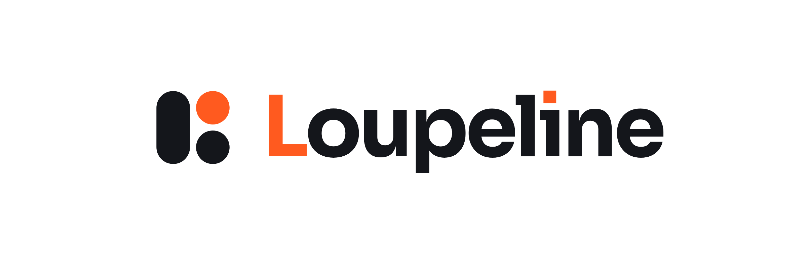
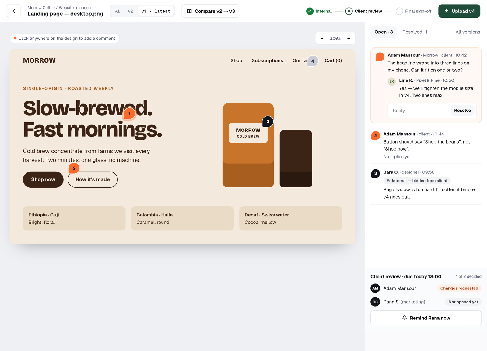
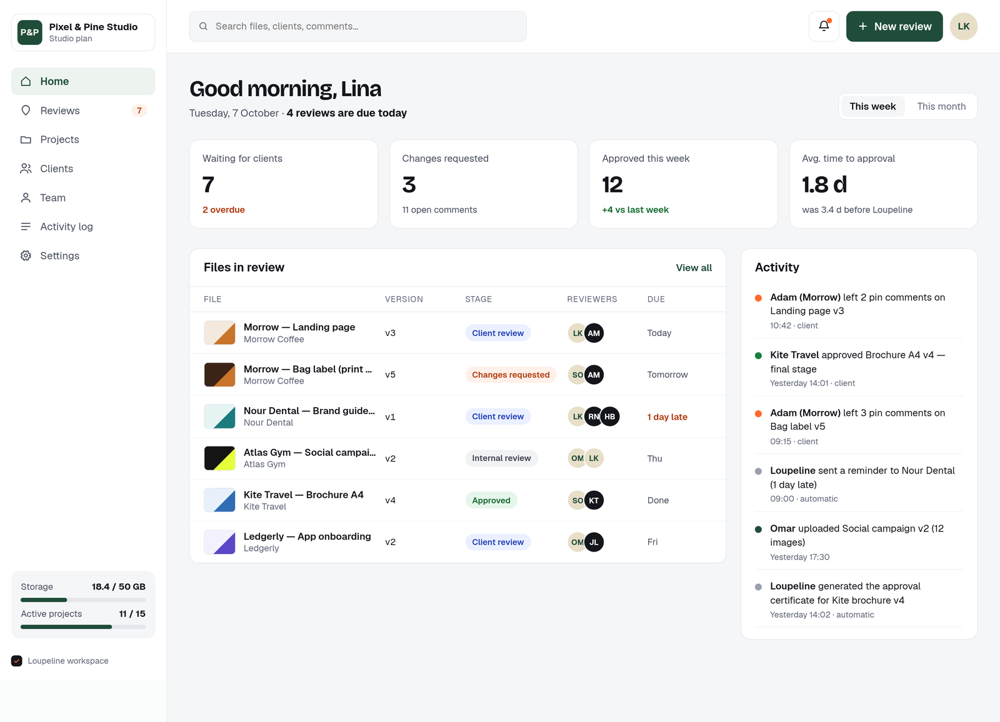
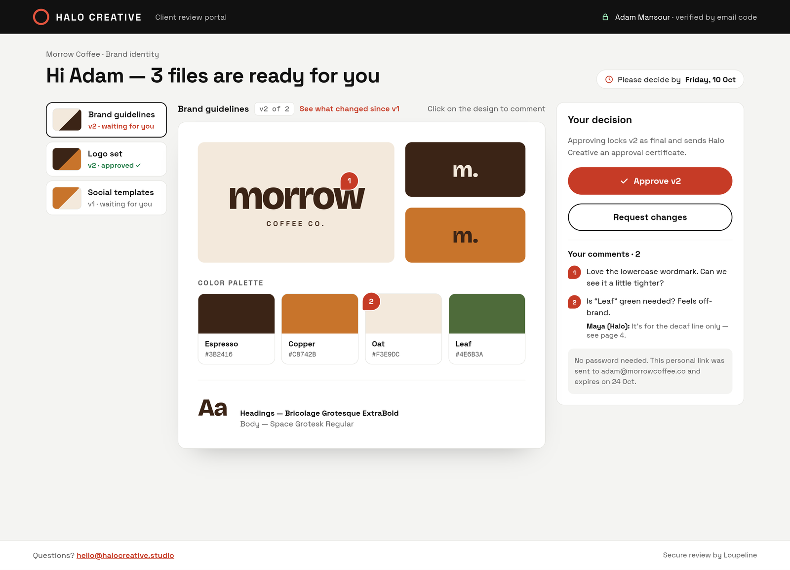
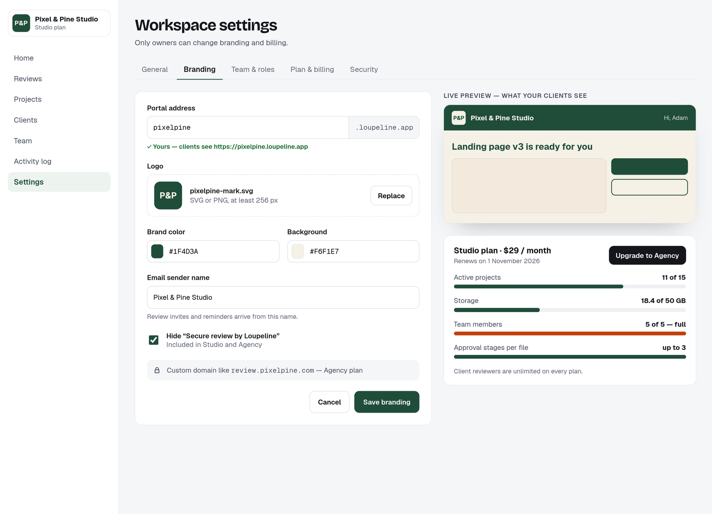
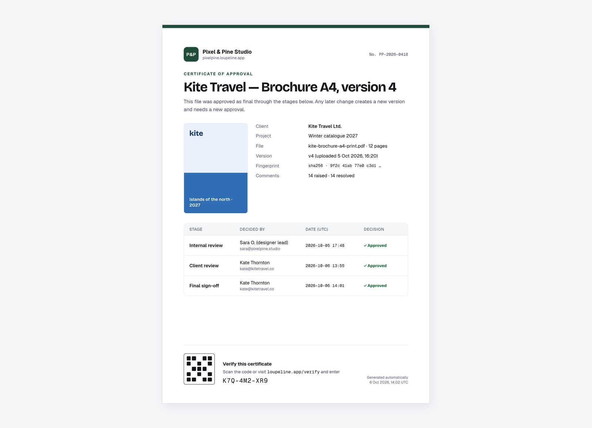
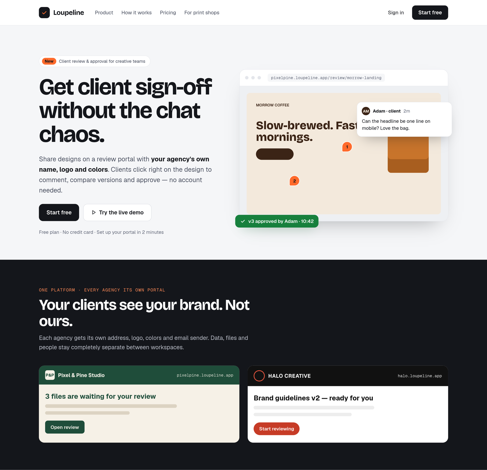
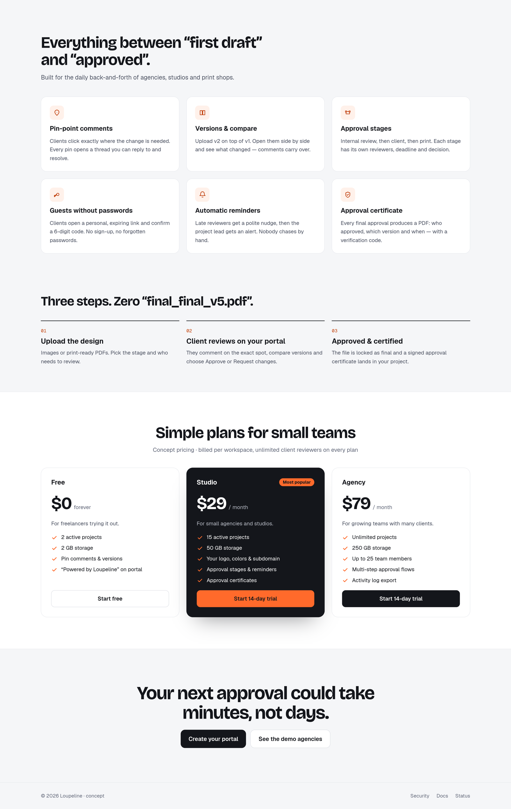
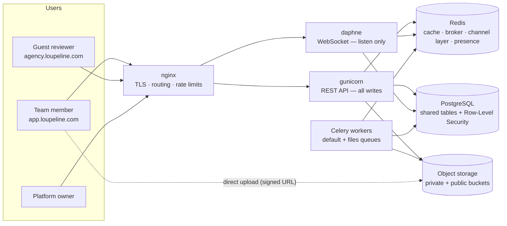

  <picture>
    <source media="(prefers-color-scheme: dark)" srcset="assets/logo/loupeline-logo-white-transparent.png">
    
  </picture>

<b>Client review and approval for creative agencies.</b>

  
   <i>Early concept mockup of the review screen. The final interface will differ.</i>

Each agency gets a review portal under its own name, logo and colours. Its clients pin comments on a design, compare versions and approve, and every final approval produces a certificate anyone can verify. One platform serves every agency, and every agency is fully isolated from the others.

> **Status:** in active development. The backend is being built in tested slices; the front end and the public launch are planned for early 2027.
> This repository documents the product and its engineering. The source code is private; access can be given to reviewers on request.

---

## The problem

Every creative agency runs the same loop every day: *design → send to the client → feedback → revise → approval*. Today that loop usually lives in WhatsApp and email:

- feedback is scattered across chats, emails and calls;
- comments are vague ("change this") with no exact place on the design;
- versions get lost ("final", "final 2", "really final");
- clients reply late, and the team chases them by hand;
- there is no proof of who approved what, and when;
- the agency delivers creative work through a chat app.

## What Loupeline does

| Feature | What it means | Backend |
|---|---|---|
| **Branded review portal** | Each agency's clients review on the agency's own subdomain (`agency.loupeline.com`), with its logo, colours and language | Built |
| **Versions and comparison** | Every upload is a numbered version; any two versions can be compared side by side | Built |
| **Multi-stage approval** | Internal review, client review, final approval — each stage with its own reviewers and due date | Built |
| **Passwordless guests** | Client reviewers have no account: a personal link plus a one-time code sent to their email | Built |
| **Real time** | Decisions, events and presence appear instantly; a dropped connection catches up without losing anything | Built |
| **Plans and billing** | Plans, limits and prices are data the platform owner edits; payment sits behind a provider interface | Built (manual payments) |
| **Two languages** | Everything the server writes exists in English and Arabic | Built |
| **Pinned comments** | Comments attached to an exact point on a page of a specific version, with replies and internal team-only comments | Next |
| **Approval certificate** | The final approval produces a PDF certificate (who approved which version, and when) with a public verification page | Planned |
| **Reminders and push** | Automatic reminders for late reviewers, then a heads-up to the project manager; phone notifications | Planned |

## Early concept

These mockups were made while planning the product, to show the experience it is aiming for. They are a first visual direction, not the final design: the front end will be built after the backend, and layouts, wording and colours will change along the way. The agencies, clients and people in them are fictional.

**Agency workspace.** What a team member sees first: files waiting on clients, requested changes, approvals this week and the latest activity.

**Review screen** (shown at the top). Pinned comments on version 3, the version switcher and comparison, the approval stages, and an internal comment the client never sees.

**Client portal.** The client reviews under the agency's own brand, with no account and no password: a personal link and a code sent to their email.

**Branding and plan settings.** The agency sets its portal address, logo, colours and email sender name, with a live preview and its plan usage beside it.

**Approval certificate.** Produced when a file is approved as final: who approved which version and when, the file fingerprint, and a code anyone can check on the verification page.

<b>Product landing page (concept)</b>

 

<i>Prices on this page are placeholders from the concept stage.</i>

## Architecture at a glance

More detail: [docs/architecture.md](docs/architecture.md) · [docs/tenant-isolation.md](docs/tenant-isolation.md) · [docs/decisions.md](docs/decisions.md)

## Engineering highlights

- **Tenant isolation in five layers.** Shared tables with a `workspace_id` on every tenant row, explicit filtering in every view, composite foreign keys that stop a row from pointing into another agency, and PostgreSQL **Row-Level Security** with `FORCE`, under three separate database roles (owner, app, platform). A test walks every model and fails if a cross-tenant foreign key lacks its composite constraint.
- **An explicit approval state machine.** Each stage moves only through defined states and events; decisions are stored per review round, so the history of v3 survives when v4 arrives; every transition runs in one transaction under a lock on the file's flow row.
- **Direct uploads, untouchable originals.** Files go from the browser straight to private storage through a signed URL. The server then checks the real content type and size, fingerprints the file, and builds previews in a background queue. Originals are never modified and are only readable through short-lived links after a permission check.
- **Writes through REST, real time as acceleration.** Every change is saved first, then broadcast after the commit. A screen that lost its connection asks for "everything after event N". Team and guest audiences are separate, so an internal event can never reach a client.
- **Separate guest identity.** A guest session cannot open any team endpoint, and a team token cannot open any portal endpoint; the split lives in the authentication layer itself.
- **Plans as data.** Code asks about a feature ("can this agency hide the Loupeline badge?"), never about a plan name.

## How it is built

Loupeline is an AI-augmented engineering project by **Mohammed Alaa Mohsen**. He specified the product, designed the architecture, and leads its **tenant-isolation and security model** — shared tables under PostgreSQL Row-Level Security, composite tenant keys and separated database roles, a choice he fixed from day one. Before any code, the product was written down as an idea document, an owner's decision log, a full architecture (15 documents and 10 architecture decision records) and a build plan split into slices.

Mohammed works in the code slice by slice together with AI coding agents that implement from those written specifications. No slice is accepted until it passes the same gate:

- the full test suite (**1,100+ automated tests**), run three ways: default, with account lockout enabled, and with `DEBUG` off as CI runs it;
- a coverage review on every line the slice changed — every uncovered line gets a test or a written reason;
- **mutation testing**: deliberate bugs are injected into the slice's code, and each one must make a test fail;
- an automated API collection (350+ checks in Postman, plus the WebSocket steps as a script) on a fresh database;
- independent review rounds by a separate reviewer agent, repeated until a round passes;
- linting, migration checks, `check --deploy`, and a dependency vulnerability audit in GitHub Actions.

Progress and decisions are written into the repository after every slice, so the project's memory lives in files, not in anyone's head. More: [docs/engineering.md](docs/engineering.md)

## Tech stack

**Backend:** Python 3.14, Django, Django REST Framework, Djoser + JWT, Google sign-in
**Data:** PostgreSQL 18 (Row-Level Security, composite constraints, UUIDv7 keys), Redis
**Async and real time:** Celery (two queues + beat), Django Channels on daphne
**Files:** S3-compatible object storage with signed URLs, background preview generation
**Operations:** nginx, gunicorn, systemd, Sentry, GitHub Actions CI, ruff, pip-audit, coverage
**Languages:** English and Arabic (Django i18n)

## Status and roadmap

See [docs/status.md](docs/status.md).

---

**Author:** Mohammed Alaa Mohsen — Gaza, Palestine
[GitHub](https://github.com/MohammedAMohsen) · [LinkedIn](https://www.linkedin.com/in/mohammed-alaa-mohsen)
