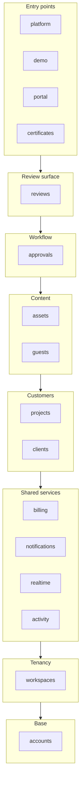

# Architecture

Loupeline is one platform that serves every agency. Each agency (a *workspace*, the tenant) is fully isolated, and each one has a review portal under its own identity for its clients.

## Components

| Component | Role |
|---|---|
| **nginx** | TLS for every subdomain, routing of REST and WebSocket traffic, request limits |
| **gunicorn** | Every REST request — and every write |
| **daphne** | Real-time connections, listen only |
| **Celery** | Email, notifications, file processing (a queue of its own), certificates, scheduled jobs |
| **Redis** | Cache, Celery broker, channel layer, presence |
| **PostgreSQL** | Shared tables, Row-Level Security, three database roles |
| **Object storage** | A private bucket for designs, a public one for brand assets |

## Django apps and their boundaries

The backend is split into apps arranged in layers. **A higher layer may depend only on lower ones, and there are no circular dependencies** ("depends" = imports its models or functions).

| App | Responsibility |
|---|---|
| `accounts` | The user's identity on the platform |
| `workspaces` | The tenant: memberships, roles and permissions, invitations, branding, and setting the current agency for a request |
| `activity` | The activity log — rows are added, never changed |
| `realtime` | The event table, publishing, group names, presence, connection tickets |
| `notifications` | One notification service: the bell, email, phone, de-duplication |
| `billing` | Plans, subscriptions, effective features, usage, invoices, payment provider |
| `clients` | An agency's clients and their guest reviewers |
| `projects` | Projects and archiving |
| `assets` | Files and versions: upload, storage, processing, previews, comparison, download |
| `guests` | Guest identity: links, one-time codes, sessions, the authentication class |
| `approvals` | The approval engine, templates, what a guest is allowed to see, and the end of version processing |
| `reviews` | Comments and replies, and the WebSocket consumers |
| `certificates` | Certificate generation and the verification page |
| `portal` | Every guest endpoint on the agency's subdomain (no tables of its own) |
| `platform` | The platform owner's dashboard (no tables of its own) |
| `demo` | The public demo |

### Three boundary decisions

1. **`portal` is a separate app with no tables.** Guest endpoints need almost everything (what the guest may see, comments, certificates). Putting them in `guests` would make a low app depend on high ones, so `guests` stays low (identity only) and `portal` sits on top.
2. **The end of version processing lives in `approvals`, not `assets`.** A ready version starts an approval round; if `assets` called the engine, the dependency would become circular. The alternative was a Django signal, and business logic in signals is not allowed in this codebase.
3. **The WebSocket consumers live in `reviews`.** Subscribing to a file's room needs "may this guest see this file?" from `approvals`, while `realtime` stays low because every app publishes through it.

## One request, end to end

*A guest reviewer approves version 3 of a file from their phone:*

1. **Browser:** `POST https://agency.loupeline.com/api/v1/portal/files/<file>/rounds/<round>/decisions/` with the session cookie and `X-CSRFToken`.
2. **nginx:** rate limit, then gunicorn.
3. **Django:** the request runs inside one database transaction.
4. **Guest authentication:** subdomain → agency → the agency is activated for the database session → session fingerprint → the guest is active. CSRF check.
5. **View (`portal`):** did version 3 reach this guest, and is this round in one of their stages?
6. **Approval engine:** locks the file's flow row, records the decision, works out the stage, and may start the next stage or approve the whole flow and lock the version. It writes the activity log and a real-time event for the right audience. **Row-Level Security** checks that every row belongs to this agency.
7. **After commit:** the event is broadcast to everyone watching the file; notifications go to the uploader and the flow's creator, in each person's language.
8. **Response:** 200 with the updated flow.

## Out of scope for version 1 — and why the design does not block it

| Item | Why the road stays open |
|---|---|
| Video review | Detected file types are an extendable list; previews per page can become per frame; a time column can be added to a comment's position; the approval engine does not care about file type |
| Integrations (Slack, Drive, Asana) | Every meaningful event already exists in the activity log and the event table; an outgoing webhook is just another consumer |
| A custom domain per agency | Only the portal lives on the agency's domain, so a domain table and a lookup by full host are enough |
| Native mobile apps | The backend is an API with JWT; the device subscription table can take APNs or FCM |
| A real payment gateway | The payment provider interface, an already designed webhook table and empty provider ID fields |
